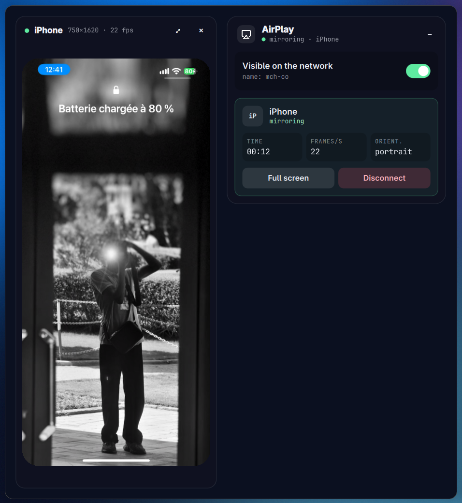
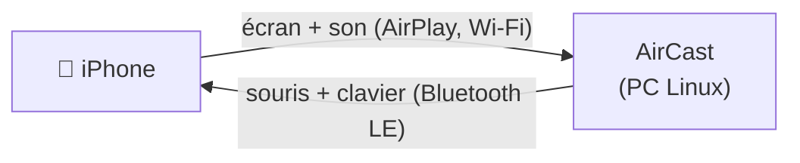

<div align="center">


# AirCast

**Voyez et contrôlez votre iPhone depuis une fenêtre de votre bureau Linux.**

AirPlay amène l'écran et le son sur le PC, le Bluetooth renvoie votre souris et votre clavier vers le téléphone.

[English](README.md) · **Français**




</div>

---

## Le problème

Un iPhone recopie son écran sur un Mac ou une Apple TV en un geste. Sous Linux, rien n'est prévu, et les outils existants restent loin de ça :

- Les récepteurs en ligne de commande ouvrent une simple fenêtre vidéo depuis un terminal, avec des options à retenir et aucun moyen de voir qui est connecté.
- Rien ne demande votre accord avant qu'un appareil du réseau affiche son écran sur votre PC.
- Le pare-feu bloque AirPlay sans rien dire, et il faut trouver quels ports ouvrir.
- On peut regarder le téléphone, mais il faut toujours le prendre en main pour le toucher.

## La solution

AirCast est une seule fenêtre qui gère les deux sens :



| Recopie | Contrôle |
| --- | --- |
| Le PC apparaît dans Centre de contrôle > Recopie de l'écran | Le PC apparaît sur le téléphone comme une souris et un clavier Bluetooth |
| Un code à quatre chiffres est demandé la première fois | Le téléphone le jumelle comme n'importe quel accessoire Bluetooth |
| L'écran et le son sont lus dans la fenêtre | Souris, clics, molette et touches sur l'image partent vers le téléphone |

Aucune application à installer sur le téléphone, aucun compte : tout repose sur ce qu'iOS sait déjà faire.

## Fonctionnalités

- **Recopie dans la fenêtre**, avec le son, la rotation, le plein écran, en H.264 et H.265.
- **Un code d'appairage** pour chaque nouvel appareil, et un bouton « Refuser ».
- **Contrôle de l'iPhone** avec la souris et le clavier du PC ; Ctrl fait office de ⌘.
- **Un interrupteur pour masquer le PC** aux appareils Apple.
- **Pare-feu pris en charge** : au premier lancement, AirCast propose d'ouvrir ses ports dans `ufw`, et c'est vous qui décidez.
- **L'écran reste éveillé** tant qu'un appareil recopie.
- **Pensé pour le clavier**, en anglais et en français, en suivant le thème et la langue d'Omarchy.

## Prérequis

- Arch Linux ou un système dérivé comme Omarchy, sous Wayland
- Un iPhone, iPad ou Mac sur le même Wi-Fi que le PC (sans réseau invité ni isolation des clients)
- `avahi-daemon` en marche, pour que les appareils Apple trouvent le PC
- Pour le contrôle : un adaptateur Bluetooth basse consommation et **BlueZ**

Sur Arch Linux :

```sh
sudo pacman -S --needed base-devel git qt6-base qt6-declarative \
    qt6-multimedia qt6-wayland gstreamer gst-plugins-base gst-plugins-good \
    gst-plugins-bad gst-libav avahi libplist openssl bluez bluez-utils
sudo systemctl enable --now avahi-daemon bluetooth
```

Optionnel : `ufw` et `polkit` pour la proposition pare-feu, `ffmpeg` pour lancer les tests. Ne lancez pas un autre récepteur AirPlay (UxPlay par exemple) en même temps.

## Installation

Une seule commande installe les dépendances et AirCast, démarre Avahi et le Bluetooth, et propose les réglages du pare-feu et du Bluetooth (elle demande avant chacun des deux) :

```sh
curl -fsSL https://raw.githubusercontent.com/mch-co/aircast/master/scripts/install.sh | bash
```

Ajoutez `-s -- --yes` après `bash` pour tout accepter. Lisez d'abord [le script](scripts/install.sh) si vous préférez ; il utilise `sudo` pour `pacman`, `systemctl`, `ufw` et `/etc/bluetooth/main.conf`.

Ou à la main :

```sh
git clone https://github.com/mch-co/aircast.git
cd aircast
bin/install
```

Les deux compilent le paquet Arch et l'installent avec `makepkg -si` : la commande `aircast`, une entrée dans le lanceur d'applications et l'icône.

La dernière version est la [v0.2.0](https://github.com/mch-co/aircast/releases/tag/v0.2.0).

Pour désinstaller :

```sh
sudo pacman -R aircast
```

## Utilisation

### Recopier l'écran

**Sur le PC**

1. Ouvrez **AirCast** depuis le lanceur d'applications.
2. Au premier lancement, choisissez **Autoriser** quand il propose d'ouvrir ses ports dans `ufw` (TCP 7000, 7100 et UDP 5353, 6000, 6001, 7011), ou **Plus tard** si vous n'avez pas de pare-feu. La question n'est posée qu'une fois.
3. Laissez **Visible sur le réseau** activé. Le panneau affiche le nom que l'iPhone listera.

**Sur l'iPhone**

1. Connectez-vous au même Wi-Fi que le PC.
2. Ouvrez le Centre de contrôle, touchez **Recopie de l'écran** et choisissez le nom du PC.
3. La première fois, saisissez le code à quatre chiffres affiché par AirCast.

L'écran apparaît dans la fenêtre, avec le son. Les boutons de volume de l'iPhone règlent le volume, et tourner le téléphone fait tourner l'image.

### Contrôler l'iPhone

**Sur le PC**

1. Une seule fois, demandez à BlueZ de s'annoncer avec une adresse privée (iOS ne liste pas un appareil Bluetooth basse consommation qui partage son adresse avec un ordinateur Bluetooth classique) :

   ```sh
   sudo cp /etc/bluetooth/main.conf /etc/bluetooth/main.conf.backup
   sudo sed -i 's/^#Privacy = off/Privacy = device/' /etc/bluetooth/main.conf
   sudo systemctl restart bluetooth
   ```

2. Ouvrez (ou redémarrez) AirCast et activez **Contrôler l'iPhone**. Il affiche « en attente de l'iPhone ».

**Sur l'iPhone**

1. Ouvrez **Réglages > Bluetooth**, choisissez **AirCast** dans Autres appareils et acceptez le jumelage. Après le premier contact, iOS peut l'afficher sous le nom du PC.
2. Activez **Réglages > Accessibilité > Toucher > AssistiveTouch**. C'est ce qui fait apparaître un pointeur ; sans lui, la souris ne fait rien.
3. Optionnel, dans le même écran : réglez la **Vitesse de déplacement**, et désactivez **Toujours afficher le menu** pour masquer le bouton flottant.

**Ensuite**

Lancez la recopie et passez la souris sur l'image. Votre curseur se masque, car le pointeur à suivre est celui de l'iPhone ; ramenez la souris vers le panneau pour retrouver votre curseur.

| Sur le PC | Sur l'iPhone |
| --- | --- |
| Déplacer la souris | Déplacer le pointeur |
| Clic gauche | Toucher (maintenir et déplacer pour glisser ou balayer) |
| Molette | Faire défiler |
| Clavier | Saisir du texte |
| Ctrl+H, ou le bouton **Accueil** | Écran d'accueil |
| Ctrl+C, Ctrl+V | Copier, coller |
| Ctrl+Espace | Recherche |

### Touches

| Touche | Action |
| --- | --- |
| Espace | Afficher ou masquer le PC sur le réseau |
| F | Plein écran (ou double-clic sur l'image) |
| Échap | Quitter le plein écran |
| D | Déconnecter |
| ? | Aide |
| Q | Quitter |

Quand vous contrôlez l'iPhone et que le pointeur est sur l'image, ces touches vont au téléphone.

## Fonctionnement

| Fichier | Rôle |
| --- | --- |
| `src/backend.{h,cpp}` | Le récepteur AirPlay : fait tourner le protocole, décode la vidéo avec GStreamer dans la fenêtre, gère le code d'appairage, la proposition pare-feu et le blocage de la veille. |
| `src/remote.{h,cpp}` | Le contrôle du téléphone : expose une souris et un clavier Bluetooth basse consommation (HID sur GATT) via BlueZ et D-Bus, et transforme la souris et les touches en rapports HID. |
| `src/Main.qml` | La fenêtre : mise en page et raccourcis clavier, sans logique. |
| `src/theme.*`, `src/translator.*` | Suivent la couleur d'accent et la langue d'Omarchy, en direct. |
| `vendor/uxplay/` | La bibliothèque AirPlay d'UxPlay (appairage, FairPlay, flux vidéo et audio), non modifiée. |

Voir [CONTRIBUTING.md](CONTRIBUTING.md) pour compiler, tester et proposer des changements.

## FAQ

**L'iPhone ne liste pas le PC dans Recopie de l'écran.**
Les deux doivent être sur le même Wi-Fi, `avahi-daemon` doit tourner, et le pare-feu doit laisser passer AirPlay : utilisez le lien « Autoriser AirPlay dans le pare-feu… » du panneau, ou ouvrez les ports listés plus haut.

**« AirCast » n'apparaît pas dans les réglages Bluetooth de l'iPhone.**
Faites l'étape `Privacy = device` ci-dessus, redémarrez AirCast, puis désactivez et réactivez le Bluetooth de l'iPhone. Si le téléphone a déjà été jumelé au PC comme appareil audio, oubliez-le d'abord des deux côtés.

**La souris ne fait rien sur l'iPhone.**
AssistiveTouch doit être activé (Réglages > Accessibilité > Toucher). Sans lui, iOS n'affiche aucun pointeur.

**Pourquoi le pointeur n'arrive-t-il pas là où je clique ?**
Une souris Bluetooth est relative : elle envoie des déplacements, pas des positions, et iOS y ajoute sa propre accélération. C'est pour cela qu'AirCast masque le curseur du PC sur l'image. Réglez la vitesse avec Vitesse de déplacement sur l'iPhone.

**Le clavier virtuel de l'iPhone a disparu.**
iOS le masque tant qu'un clavier Bluetooth est connecté. Tapez sur le PC, ou désactivez « Contrôler l'iPhone ».

**Y a-t-il un décalage ?**
Un peu, comme pour toute recopie d'écran en Wi-Fi. C'est sans gêne pour les apps, les photos et la vidéo ; les jeux rapides le ressentiront.

**Peut-il envoyer l'écran de mon PC vers une Apple TV ?**
Non. AirCast ne fait que recevoir.

**Fonctionne-t-il sur d'autres distributions, macOS ou Windows ?**
Seul Linux basé sur Arch est empaqueté et testé pour l'instant. Un Mac n'en a pas besoin : macOS intègre la réception AirPlay et la recopie de l'iPhone.

## Crédits et licence

AirCast est un projet indépendant, ni affilié à Apple ni approuvé par Apple. AirPlay, iPhone, iPad et Mac sont des marques d'Apple Inc.

Le code du protocole AirPlay dans `vendor/uxplay` est la bibliothèque d'[UxPlay](https://github.com/FDH2/UxPlay) 1.73.7 (GPL-3.0), non modifiée ; AirCast est donc aussi sous GPL-3.0. `theme` et `translator` viennent des modèles d'applications Omarchy (Omacut et Monologue, MIT, David Heinemeier Hansson).
