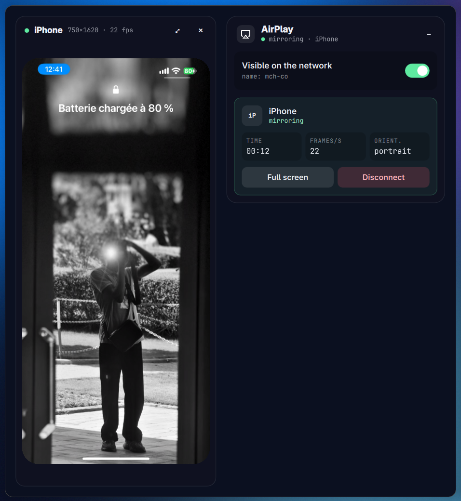

# AirCast



An AirPlay receiver for Omarchy. Open it, and your iPhone, iPad or Mac can
mirror its screen (with sound) into the window: Control Center > Screen
Mirroring > the name of this computer. The first time, the phone asks for the
four-digit code AirCast shows.

Both devices must be on the same network, and `avahi-daemon` must be running.
H.264 and H.265 sources are decoded, and the screen stays awake while a device
is mirroring.

| Key   | Action                                    |
| ----- | ----------------------------------------- |
| Space | Show or hide this computer on the network |
| F     | Full screen                               |
| Esc   | Exit full screen                          |
| D     | Disconnect                                |
| ?     | Help                                      |
| Q     | Quit                                      |

On first launch AirCast offers to open its ports in `ufw` (TCP 7000, 7100 and
UDP 5353, 6000, 6001, 7011); the choice is yours and is asked once.

## Requirements

- Arch Linux or an Arch-based system such as Omarchy, on Wayland.
- An iPhone, iPad or Mac on the same network as this computer (same Wi-Fi,
  no guest or client isolation).
- `avahi-daemon` running, so Apple devices can find this computer:
  `sudo systemctl enable --now avahi-daemon`
- The build tools and libraries:

  ```sh
  sudo pacman -S --needed base-devel git qt6-base qt6-declarative \
      qt6-multimedia qt6-wayland gstreamer gst-plugins-base gst-plugins-good \
      gst-plugins-bad gst-libav avahi libplist openssl
  ```

- Optional: `ufw` and `polkit`, for the first-launch offer to open the
  firewall ports. With another firewall, open them yourself: TCP 7000, 7100
  and UDP 5353, 6000, 6001, 7011.
- Optional: `ffmpeg`, only to run the tests.
- No other AirPlay receiver (UxPlay, for example) running at the same time.

## Install

```sh
git clone https://github.com/mch-co/aircast.git
cd aircast
bin/install
```

`bin/install` builds the Arch package and installs it with `makepkg -si`, so
AirCast shows up in the app launcher. Build only with `bin/build`, test with
`bin/test`.

## Credits and license

AirCast is an independent project, not affiliated with or endorsed by Apple.
AirPlay, iPhone, iPad and Mac are trademarks of Apple Inc.

The AirPlay protocol code in `vendor/uxplay` is the library of
[UxPlay](https://github.com/FDH2/UxPlay) 1.73.7 (GPL-3.0), unmodified, so
AirCast is GPL-3.0 too. `theme` and `translator` come from the Omarchy app
templates (Omacut and Monologue, MIT, David Heinemeier Hansson).
