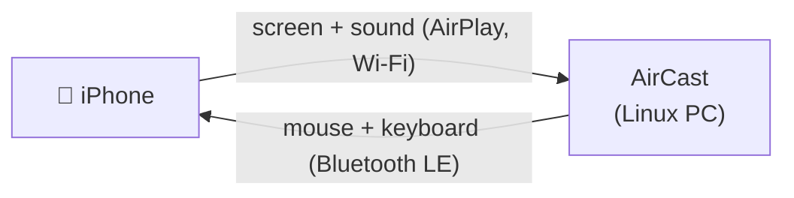

<div align="center">


# AirCast

**See and control your iPhone from a window on your Linux desktop.**

AirPlay brings the screen and sound to the PC, Bluetooth takes your mouse and keyboard back to the phone.

**English** · [Français](README.fr.md)


</div>

---

## The problem

An iPhone mirrors its screen to a Mac or an Apple TV with one tap. On Linux there is nothing built in, and the tools that exist fall short of that:

- Command-line receivers open a bare video window from a terminal, with flags to remember and no way to see who is connected.
- Nothing asks before a device on the network starts showing its screen on your PC.
- The firewall silently blocks AirPlay, and you have to find which ports to open.
- You can look at the phone, but you still have to pick it up to touch it.

## The solution

AirCast is one window that does both directions:



| Mirroring | Control |
| --- | --- |
| The PC appears in Control Center > Screen Mirroring | The PC appears on the phone as a Bluetooth mouse and keyboard |
| A four-digit code is asked the first time | The phone pairs it like any Bluetooth accessory |
| The screen and sound play inside the window | Mouse, clicks, wheel and keys over the picture go to the phone |

No app to install on the phone, and no account: it uses what iOS already has.

## Features

- **Mirroring in the window**, with sound, rotation, full screen, H.264 and H.265.
- **A pairing code** for every new device, and a "Refuse" button.
- **Control the iPhone** with the PC's mouse and keyboard; Ctrl works as ⌘.
- **One switch to hide the PC** from Apple devices.
- **Firewall handled for you**: on first launch AirCast offers to open its ports in `ufw`, and you decide.
- **The screen stays awake** while a device is mirroring.
- **Keyboard first**, in English and French, following the Omarchy theme and language.

## Requirements

- Arch Linux or an Arch-based system such as Omarchy, on Wayland
- An iPhone, iPad or Mac on the same Wi-Fi as the PC (no guest network or client isolation)
- `avahi-daemon` running, so Apple devices can find the PC
- For control: a Bluetooth LE adapter and **BlueZ**

On Arch Linux:

```sh
sudo pacman -S --needed base-devel git qt6-base qt6-declarative \
    qt6-multimedia qt6-wayland gstreamer gst-plugins-base gst-plugins-good \
    gst-plugins-bad gst-libav avahi libplist openssl bluez bluez-utils
sudo systemctl enable --now avahi-daemon bluetooth
```

Optional: `ufw` and `polkit` for the firewall offer, `ffmpeg` to run the tests. Don't run another AirPlay receiver (UxPlay, for example) at the same time.

## Install

One command installs the dependencies and AirCast, starts Avahi and Bluetooth, and offers the firewall and Bluetooth settings (it asks before each of those two):

```sh
curl -fsSL https://raw.githubusercontent.com/mch-co/aircast/master/scripts/install.sh | bash
```

Add `-s -- --yes` after `bash` to accept every question. Read [the script](scripts/install.sh) first if you prefer; it uses `sudo` for `pacman`, `systemctl`, `ufw` and `/etc/bluetooth/main.conf`.

Or by hand:

```sh
git clone https://github.com/mch-co/aircast.git
cd aircast
bin/install
```

Both build the Arch package and install it with `makepkg -si`: the `aircast` command, an app launcher entry, and the icon.

The latest release is [v0.2.0](https://github.com/mch-co/aircast/releases/tag/v0.2.0).

To uninstall:

```sh
sudo pacman -R aircast
```

## Usage

### Mirror the screen

**On the PC**

1. Open **AirCast** from the app launcher.
2. On first launch, choose **Allow** when it offers to open its ports in `ufw` (TCP 7000, 7100 and UDP 5353, 6000, 6001, 7011), or **Not now** if you have no firewall. It is asked once.
3. Leave **Visible on the network** on. The panel shows the name the iPhone will list.

**On the iPhone**

1. Connect to the same Wi-Fi as the PC.
2. Open Control Center, tap **Screen Mirroring** and choose the PC's name.
3. The first time, type the four-digit code AirCast shows.

The screen appears in the window, with sound. The iPhone's volume buttons set the volume, and rotating the phone rotates the picture.

### Control the iPhone

**On the PC**

1. Once, tell BlueZ to advertise from a private address (iOS doesn't list a Bluetooth LE device that shares its address with a classic Bluetooth computer):

   ```sh
   sudo cp /etc/bluetooth/main.conf /etc/bluetooth/main.conf.backup
   sudo sed -i 's/^#Privacy = off/Privacy = device/' /etc/bluetooth/main.conf
   sudo systemctl restart bluetooth
   ```

2. Open (or restart) AirCast and turn on **Control the iPhone**. It shows "waiting for the iPhone".

**On the iPhone**

1. Open **Settings > Bluetooth**, choose **AirCast** under Other Devices and accept the pairing. After the first contact iOS may list it under the PC's name.
2. Turn on **Settings > Accessibility > Touch > AssistiveTouch**. This is what gives a pointer; without it the mouse does nothing.
3. Optional, in the same screen: set **Tracking Speed**, and turn off **Always Show Menu** to hide the floating button.

**Then**

Start mirroring and move the mouse over the picture. Your cursor hides, because the pointer to watch is the one on the iPhone; move the mouse back to the panel to get your cursor.

| On the PC | On the iPhone |
| --- | --- |
| Move the mouse | Move the pointer |
| Left click | Tap (hold and move to drag or swipe) |
| Wheel | Scroll |
| Keyboard | Type |
| Ctrl+H, or the **Home** button | Home screen |
| Ctrl+C, Ctrl+V | Copy, paste |
| Ctrl+Space | Search |

### Keys

| Key | Action |
| --- | --- |
| Space | Show or hide the PC on the network |
| F | Full screen (also a double-click on the picture) |
| Esc | Exit full screen |
| D | Disconnect |
| ? | Help |
| Q | Quit |

While you control the iPhone and the pointer is over the picture, these keys go to the phone.

## How it works

| File | Role |
| --- | --- |
| `src/backend.{h,cpp}` | The AirPlay receiver: runs the protocol, decodes the video with GStreamer into the window, handles the pairing code, the firewall offer and the idle lock. |
| `src/remote.{h,cpp}` | Phone control: serves a Bluetooth LE mouse and keyboard (HID over GATT) through BlueZ over D-Bus, and turns mouse and key events into HID reports. |
| `src/Main.qml` | The window: layout and keyboard shortcuts, no logic. |
| `src/theme.*`, `src/translator.*` | Follow the Omarchy accent and language, live. |
| `vendor/uxplay/` | UxPlay's AirPlay library (pairing, FairPlay, the mirror and audio streams), unmodified. |

See [CONTRIBUTING.md](CONTRIBUTING.md) to build, test and send changes.

## FAQ

**The iPhone doesn't list the PC in Screen Mirroring.**
Both must be on the same Wi-Fi, `avahi-daemon` must be running, and the firewall must let AirPlay through: use the "Allow AirPlay through the firewall…" link in the panel, or open the ports listed above.

**"AirCast" doesn't appear in the iPhone's Bluetooth settings.**
Do the `Privacy = device` step above, restart AirCast, then turn the iPhone's Bluetooth off and on. If the phone was ever paired with the PC as an audio device, forget it on both sides first.

**The mouse does nothing on the iPhone.**
AssistiveTouch must be on (Settings > Accessibility > Touch). Without it iOS shows no pointer.

**Why doesn't the pointer land where I click?**
A Bluetooth mouse is relative: it sends movements, not positions, and iOS adds its own acceleration. That is why AirCast hides the PC cursor over the picture. Adjust the speed with Tracking Speed on the iPhone.

**The iPhone's on-screen keyboard is gone.**
iOS hides it while a Bluetooth keyboard is connected. Type on the PC, or turn off "Control the iPhone".

**Is there a delay?**
A little, as with any screen mirroring over Wi-Fi. It is fine for apps, photos and video; fast games will feel it.

**Can it send my PC's screen to an Apple TV?**
No. AirCast only receives.

**Does it work on other distributions, macOS or Windows?**
Only Arch-based Linux is packaged and tested for now. A Mac doesn't need it: macOS has AirPlay receiving and iPhone Mirroring built in.

## Credits and license

AirCast is an independent project, not affiliated with or endorsed by Apple. AirPlay, iPhone, iPad and Mac are trademarks of Apple Inc.

The AirPlay protocol code in `vendor/uxplay` is the library of [UxPlay](https://github.com/FDH2/UxPlay) 1.73.7 (GPL-3.0), unmodified, so AirCast is GPL-3.0 too. `theme` and `translator` come from the Omarchy app templates (Omacut and Monologue, MIT, David Heinemeier Hansson).
